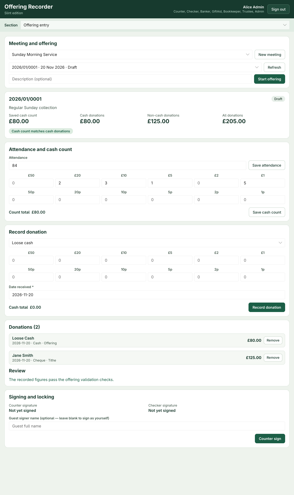
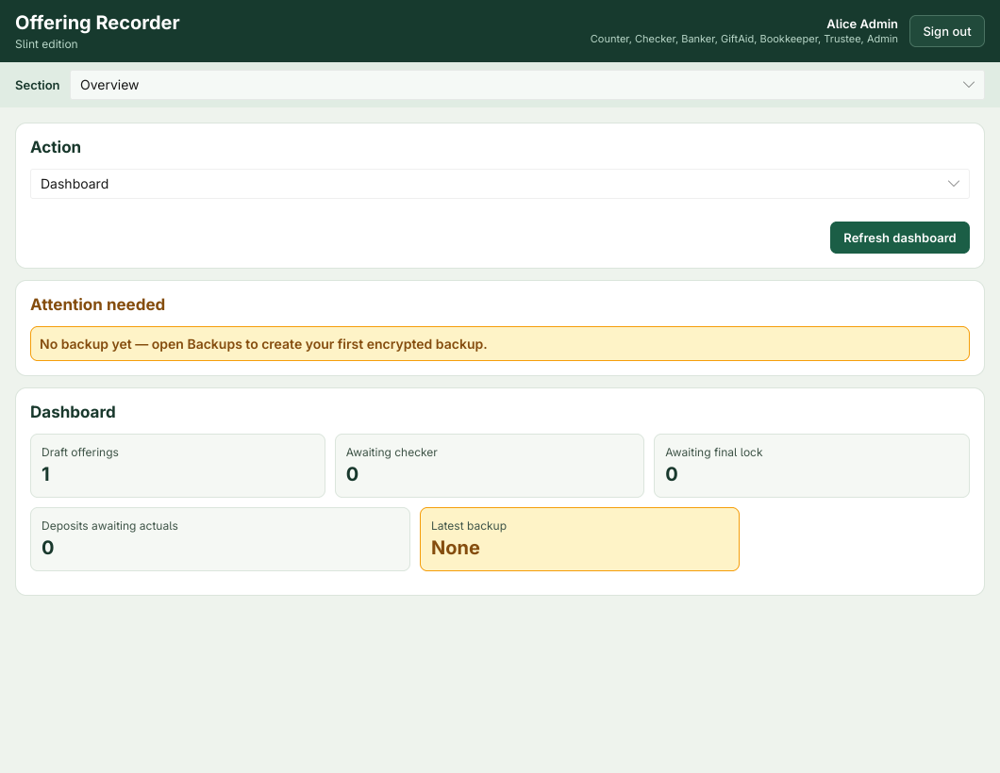
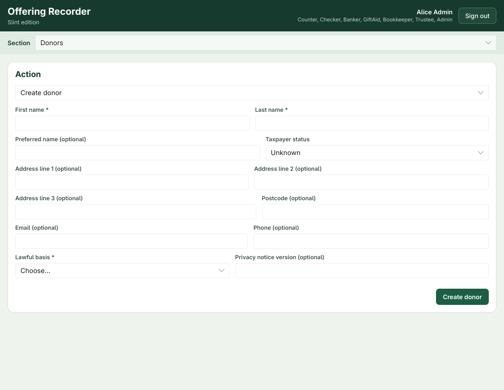
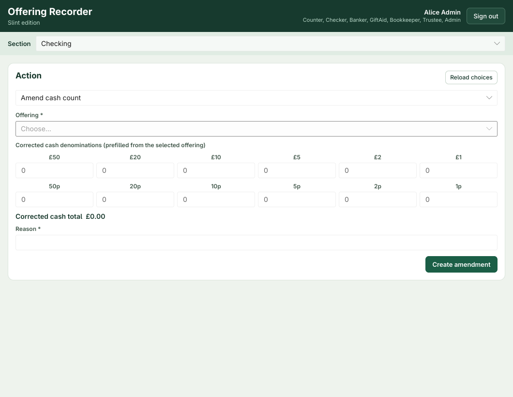
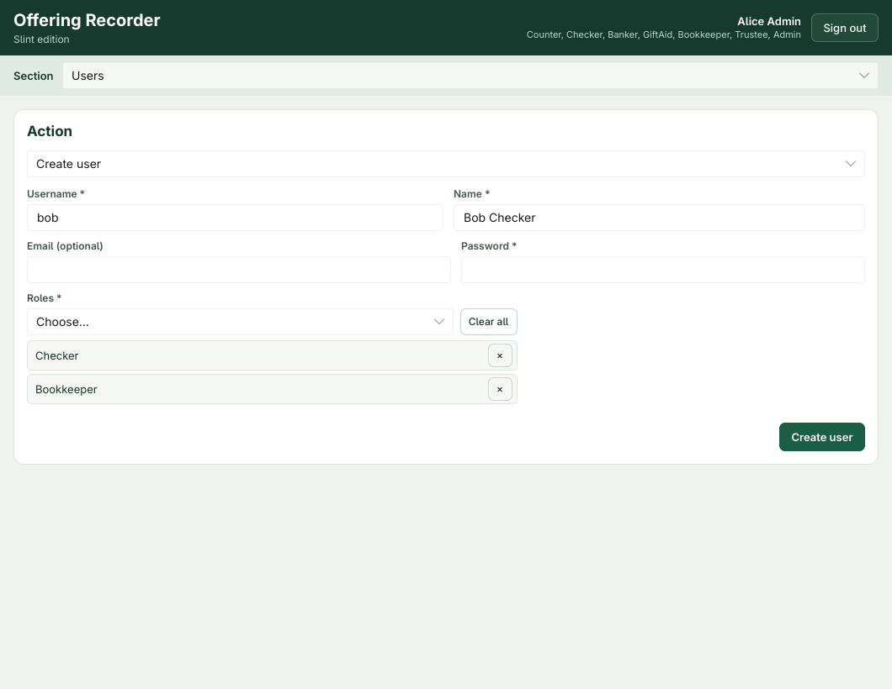
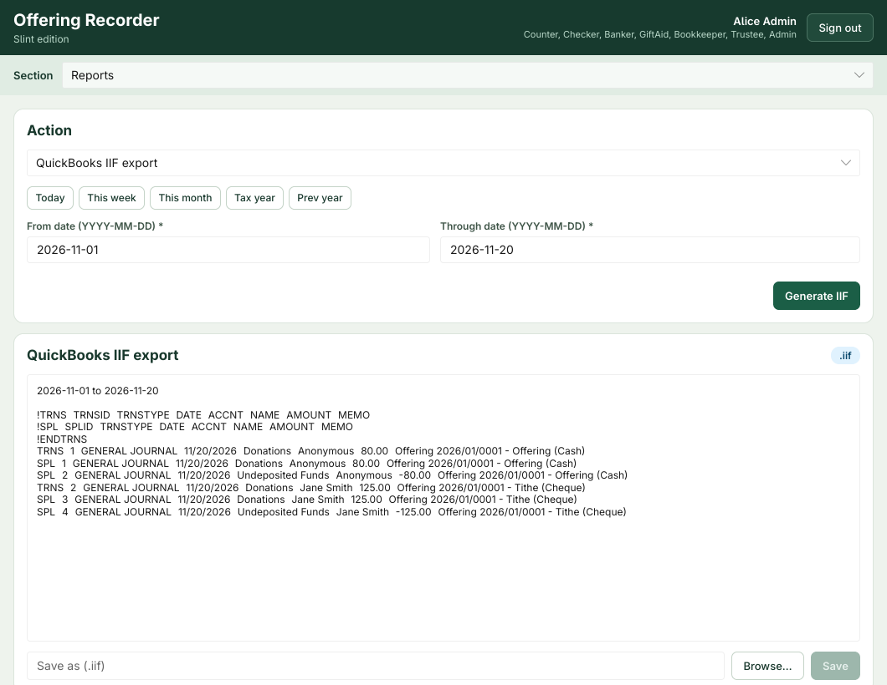
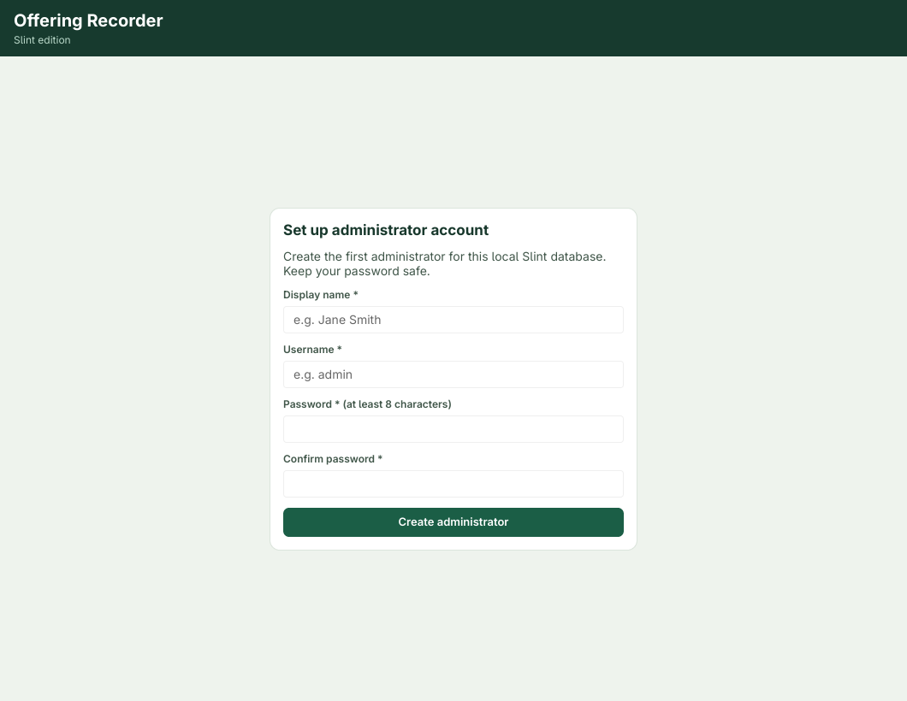
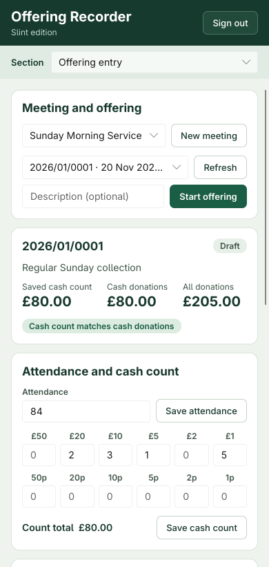

<div align="center">

# Offering Recorder

**Offline-first church donation recording for UK churches.**
Meetings, offerings, cash counting, donors, Gift Aid, GASDS, two-person signing,
bank reconciliation, reports, audit trail and encrypted backups.

Two front ends on one shared Rust core: a **Tauri + SvelteKit** web-view app
and a **native Slint** desktop app.



</div>

## Contents

- [Highlights](#highlights)
- [Screenshots](#screenshots)
- [Choose a front end](#choose-a-front-end)
- [Native Slint edition](#native-slint-edition)
- [Tauri + Svelte edition](#tauri--svelte-edition)
- [Architecture](#architecture)
- [Roles (RBAC)](#roles-rbac)
- [Dual control](#dual-control-procedural) · [Backups](#backups) · [GDPR](#gdpr--retention-notes)
- [Key domain rules](#key-domain-rules)

## Highlights

- **Counting that matches the bank.** Per-denomination cash counts, donation
  breakdowns and a live reconciliation badge between counted cash and recorded cash gifts.
- **Two-person control.** Counter → checker → lock, enforced with segregation of
  duties. Locked offerings change only through approved, append-only amendments.
- **UK Gift Aid and GASDS built in.** Declarations, eligibility per donation date,
  claim readiness, the 10:1 GASDS match and annual ceilings.
- **Money is integer pence.** Checked arithmetic everywhere, no floats.
- **Audit and privacy.** Full audit trail, lawful-basis tracking, subject-access
  reports, Admin-only PII redaction, 7-year retention review.
- **Safe backups.** AES-256-GCM + Argon2id, validate-before-restore, safety copy.
- **Role-aware UI.** Each user sees only the sections their roles permit, and
  every permission is enforced in the backend, not just hidden in the UI.

## Screenshots

Rendered headlessly from the native Slint edition with the software renderer.

| Offering entry | Dashboard |
| :---: | :---: |
|  |  |
| Cash grid, donations, reconciliation and inline signing | Metric cards and attention banners, loaded automatically |

| Create donor | Amend cash count |
| :---: | :---: |
|  |  |
| Two-column forms with clear required and optional fields | Prefilled denomination grid with a live total |

| Users and roles | Reports and export |
| :---: | :---: |
|  |  |
| Add roles from a menu, remove them with the × chip | Date presets, monospace output, Browse and Save |

| First-run setup | Narrow window (390px) |
| :---: | :---: |
|  |  |
| Password confirmation on first run | Layout adapts to small windows |

## Choose a front end

| | Native Slint | Tauri + Svelte |
| --- | --- | --- |
| UI | Slint (`src-slint/`) | SvelteKit in a web view (`src/`, `src-tauri/`) |
| Database | Its own SQLite file | Its own SQLite file |
| Core logic | Shared `crates/*` | Shared `crates/*` |
| Run | `cargo run --locked --manifest-path src-slint/Cargo.toml` | `bun run tauri dev` |

The two editions keep **separate databases**, so you can run them side by side
with test data and compare behaviour.

## Native Slint edition

Needs Rust 1.95 or newer.

```sh
cargo run --release --locked --manifest-path src-slint/Cargo.toml
```

Data lives in `offering-recorder-slint` under the OS local data directory (on
Linux, `${XDG_DATA_HOME:-$HOME/.local/share}/offering-recorder-slint`). On first
run you create the administrator account.

**Offering entry** covers meetings, offerings, attendance, cash counting, donor
search and creation, cash and non-cash donations, validation, and inline
counter-sign, checker-sign, withdraw and lock.

**Workspace sections** (filtered by your roles):

| Section | What you can do |
| --- | --- |
| Overview | Dashboard metrics, backup and Gift Aid deadline alerts, checking queue |
| Meetings | Meetings, event details, community buildings |
| Checking | Signing, withdrawal, locking, offering amendments |
| Donors | Directory, profiles, GDPR subject-access report, CSV import, PII redaction |
| Gift Aid | Declarations, eligibility, declaration amendments |
| Banking | Deposit candidates, deposits, bank actuals |
| Claims | GASDS readiness, draft, prepare, submit, approve, reject |
| Reports | Bookkeeping, donor, Gift Aid, GASDS, deposit, QuickBooks IIF with date presets |
| Users | Create users, reset passwords, activate and deactivate |
| Audit | Audit log and retention review |
| Backups | Create, validate, restore, prune |

Read-only views load automatically. Destructive actions ask for confirmation and
check required fields first. Result files are written with `0600` permissions and
never overwrite an existing file. Browse buttons use `zenity` or `kdialog` when
installed, and you can always type a path.

Verified on Linux (`x86_64-unknown-linux-gnu`) and with the ARM64 Android APK
on an Android 16 emulator. Windows, macOS, iOS, and browser builds remain unverified.

### Slint checks

```sh
cargo fmt --manifest-path src-slint/Cargo.toml --check
cargo clippy --locked --all-targets --manifest-path src-slint/Cargo.toml -- -D warnings
cargo test --locked --manifest-path src-slint/Cargo.toml
```

The tests include a full end-to-end workflow across every section and a headless
render of the main screens. To regenerate the screenshots in `docs/screenshots/`:

```sh
SLINT_WALKTHROUGH_DIR=docs/screenshots \
  cargo test --locked --manifest-path src-slint/Cargo.toml headless_ui_renders_all_redesigned_screens
```

That writes `.ppm` files; convert them with ImageMagick
(`magick in.ppm out.png`).

## Tauri + Svelte edition

### Prerequisites

- Rust stable ≥ 1.94 (`rustup update stable`)
- Bun ≥ 1.x (canonical JS package manager — `bun.lock` is authoritative)
- Tauri system deps (see [Tauri prerequisites](https://tauri.app/start/prerequisites/))
- Optional: `sqlx-cli` for migration work (`cargo install sqlx-cli --no-default-features --features sqlite`)

No `DATABASE_URL` needed at runtime: migrations are embedded
(`crates/infrastructure/src/db.rs` → `sqlx::migrate!("../../migrations")`).

### Quick start

```sh
bun install
bun run check      # svelte-check (must be 0 errors / 0 warnings)
bun run build      # frontend build (Tauri beforeBuildCommand also uses this)
cargo test --workspace
cargo clippy --workspace --all-targets -- -D warnings
cargo fmt --check
```

Desktop dev/build: `bunx tauri dev` / `bunx tauri build`
(or `bun run tauri dev` via the `tauri` script).

## CI downloads

Open a **Build artifacts** run in GitHub Actions and download its artifacts. The workflow runs on pull requests, pushes to `main`, version tags, and manual dispatch.

| Target | Artifact |
| --- | --- |
| Linux x64 | Slint executable archive and Tauri Debian package |
| Windows x64 | Slint executable archive and Tauri NSIS installer |
| macOS Apple Silicon and Intel | Slint executable archives and Tauri disk images |
| Android ARM64 | Slint and Tauri debug APKs for testing |
| iOS ARM64 | Slint Apple Silicon simulator app, unsigned Slint and Tauri device archives, and an opt-in signed Slint IPA for TestFlight |
| Web | Static Svelte assets. App workflows still require Tauri's Rust backend. |

CI packages Tauri with the bundle identifier `com.caleb.offeringrecorder`. Its app data directory can differ from local development installations. The workflow uploads build artifacts to Actions.

### Install on Android

Download `slint-android-arm64-debug` from the completed workflow run and extract
`offering-recorder-slint.apk`. On an ARM64 phone running Android 8 or later,
open the APK in Files and allow installation from that source if prompted.

To install over USB, enable USB debugging, connect the phone, and accept its
debugging prompt. From the directory containing the APK, run these commands
with Android SDK Platform-Tools installed. [Android Platform-Tools](https://developer.android.com/tools/releases/platform-tools)

```sh
adb devices
adb install -r offering-recorder-slint.apk
```

Debug builds from different CI runs can have different signing keys. If Android
rejects an update because the signatures differ, export a backup from the old
build before uninstalling it. Uninstalling removes the app’s local data.

### Install on iPhone with TestFlight

Use the signed TestFlight build to install on a physical iPhone running iOS 15 or
later without a local Mac. The regular workflow produces
`slint-ios-arm64-device-unsigned`, which contains an Xcode archive for signing
and packaging. iOS requires a signed build for device installation.

1. In the Apple Developer portal, register the explicit App ID
   `com.caleb.offeringrecorder.slint`. Use it to create the iOS app record in
   App Store Connect. Create an Apple Distribution certificate with its private
   key exported as a password-protected `.p12`, and an App Store Connect
   provisioning profile for this App ID and certificate.
2. Create an App Store Connect team API key with upload access. In the GitHub
   repository, go to **Settings → Secrets and variables → Actions** and add
   the following repository secrets. To encode each file as a single line on
   Linux, use `base64 -w0 path/to/file`. [GitHub signing setup](https://docs.github.com/en/actions/how-tos/deploy/deploy-to-third-party-platforms/sign-xcode-applications) · [Apple build uploads](https://developer.apple.com/help/app-store-connect/manage-builds/upload-builds/)

   | Secret | Value |
   | --- | --- |
   | `IOS_CERTIFICATE_BASE64` | Base64-encoded distribution certificate and private key in the `.p12` |
   | `IOS_CERTIFICATE_PASSWORD` | Password used when exporting the `.p12` |
   | `IOS_PROFILE_BASE64` | Base64-encoded App Store Connect `.mobileprovision` |
   | `ASC_API_KEY_BASE64` | Base64-encoded App Store Connect API key `.p8` |
   | `ASC_KEY_ID` | App Store Connect API key ID |
   | `ASC_ISSUER_ID` | App Store Connect team issuer ID |

3. Open **Actions → Build artifacts → Run workflow**, choose `main`, and enable
   `upload_testflight`. The runner signs and exports the IPA, uploads it as
   `slint-ios-arm64-app-store-ipa`, and submits the build to App Store Connect
   for processing. [Build artifacts workflow](https://github.com/Cal3165/offering_recorder/actions/workflows/artifacts.yml)
4. After processing, open **App Store Connect → TestFlight**. Resolve any
   outstanding compliance questions, add the build to an internal testing
   group, and invite your testers. Open the invitation on the iPhone and
   install the build in Apple’s TestFlight app. [Apple TestFlight overview](https://developer.apple.com/testflight/)

### Run in the iOS Simulator

On an Apple Silicon Mac, download and extract `slint-ios-arm64-simulator`.
Boot a simulator and run `xcrun simctl install booted OfferingRecorderSlint.app`
from the extracted app’s parent directory.

### Import and export files on mobile

The app stores its SQLite database inside its private mobile container. In
**Donors → Import donors from CSV**, use **Choose CSV…** to select a document.
On an exportable result, use **Save to Files…** to choose a destination.
The native picker handles the selected document. Slint keeps temporary copies
in private app storage during the transfer.

## Architecture

```
crates/domain/          Entities, value objects (Money, Postcode, TaxYear),
                        business rules (GASDS, Gift Aid, signing state machine).
                        No SQLite / Tauri deps.
crates/application/     Use cases, services, RBAC/permission gates, ports.
crates/persistence/     Repository traits (+ shared error type).
crates/infrastructure/  SQLite impls, auth (Argon2), encrypted backups.
src-tauri/              Tauri wiring: commands/* (one `with_actor!` gate per command),
                        pool/store setup, capabilities.
src/lib/                Svelte UI only (no HMRC math — display aggregation only).
migrations/             Strictly additive SQL migrations (old DBs upgrade in place).
crates/application/tests/workflows.rs  Service-level integration suite (in-memory SQLite).
```

Dependency direction: `domain ← persistence ← application ← infrastructure`,
`src-tauri` wires all four. Never invert it.

## Roles (RBAC)

Counter, Checker, Banker, GiftAid, Bookkeeper, Trustee, Admin (Admin holds all).
Backend services enforce every permission — hidden buttons are defence-in-depth only.
Guards: last active admin cannot be deactivated (`crates/application/src/auth.rs`).

Deliberate scopes (see `crates/application/src/permissions.rs`):
- Counter manages donors (on-the-spot creation during offering entry needs it).
- Trustee manages donors (donor-roll maintenance for examination); backup but
  never restore; read-only on claims (no Claims tab).
- Bookkeeper is report-only; banking writes belong to Banker (grant both roles
  to a treasurer who needs both).

## Dual control (procedural)

Counter → checker → lock is enforced in software with segregation-of-duties,
but guest names on a shared device cannot prove physical identity: one
operator could invent two guest names. The review screen says the signers
must be different real people, and both signatures permanently record the
operator id so same-operator dual signing is detectable in the audit trail.
Enforce the two-person rule at the count table; do not rely on software alone.

## Backups

Manual creation only (encrypted AES-256-GCM + Argon2id recommended; empty
passphrase means an UNENCRYPTED backup and requires explicit confirmation).
There is no automatic scheduler by design for this single-desktop app: the
Dashboard shows a 7-day overdue badge — treat it as a rota duty. Keep 2–3
recent backups; restore validates first, keeps a timestamped safety copy,
and swaps atomically. Operational log: `offering_recorder.log` next to the
database (daily rotation); the UI shows generic messages for infrastructure
failures, details go to the log.

## GDPR / retention notes

- Lawful basis (Article 6) is recorded per donor plus the privacy-notice
  version; "Not recorded" (pre-existing rows, or review-needed imports) is
  surfaced in the UI for completion. Basis changes are audited (DonorChanged).
- Subject-access export bundles donor, donations, declarations, declaration
  amendments, offering amendments, and the full audit trail for all of those.
- Audit events store PII snapshots indefinitely with the business records;
  retention is 7 years minimum, report-only — nothing auto-deletes. Review
  before any disposal; do not delete rows under HMRC enquiry/dispute.
  Justification and the erasure path are documented in the DPIA note at the
  top of `crates/application/src/audit.rs`.
- Erasure (Article 17) is served by Admin-only PII redaction
  (`redact_donor_pii`): identifying fields are erased while the row, donation
  links and audit history are retained. Redaction is refused while any of the
  donor's donations or declarations sits inside the 7-year HMRC window.
- CSV imports take one explicit lawful basis per batch (or "Not recorded",
  the default) and flag imported rows for per-donor review.

## Release profile

`panic = "unwind"` is intentional (see `[profile.release]` in the workspace
`Cargo.toml`): a panic in a Tauri command/task unwinds to a window error
instead of killing the whole desktop process. Business writes precede their
audit writes by design (`AuditLog::record` docs in `crates/application/src/audit.rs`):
on audit failure the caller gets an error for an already-committed write —
surface it, do not blind-retry.

## Key domain rules

- Money is integer pence everywhere; checked arithmetic (`Money::sum`), no floats.
- UK tax year starts 6 April (`crates/domain/src/tax_year.rs`).
- Gift Aid eligibility is evaluated per donation date against the declaration window
  valid on that date — never current status.
- GASDS: £30/donation limit (£20 pre-Apr-2019), £50 notes excluded, 10× Gift Aid
  matching + £8,000 annual ceiling (£5,000 pre-Apr-2016), banked cash only.
- Offerings: Draft → CounterSigned → CheckerSigned → Locked; locked data changes only
  via approved amendments (append-only, original preserved, reconstruction supported).
- Retention: 7 years minimum, report-only — nothing auto-deletes.
- Backups: AES-256-GCM + Argon2id; empty passphrase means UNENCRYPTED (explicit confirm).

## Docs

- `MVP.md` — scope in/out.
- `Plan.md` — original build plan (historical).
- `REVIEW_FIX_PLAN.md` — active fix plan; the single source of truth for outstanding work.
- `review.md` — FROZEN historical audit log (2026-08-24). Do not append; use GitHub issues.
